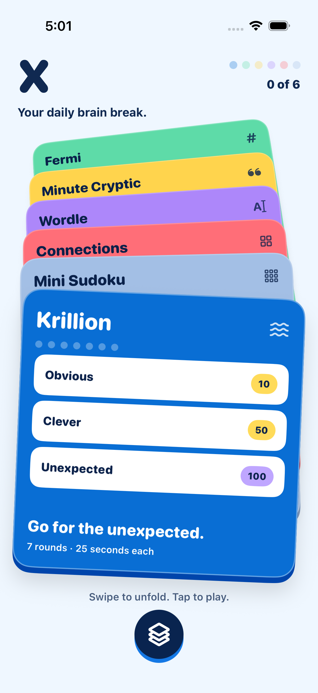

# Daisy — your daily brain break

A native iPhone app with six daily puzzle games, an animated open-fold card deck, and one circular control for the collection. SwiftUI, iOS 17+, no runtime dependencies.

Swipe the folded cards to explore: up or left deals the next game from below, down or right sends the front card away, or tap a card's edge to bring it forward. Tap the front card to play. Open the circle to browse all games, revisit the previous 30 days, or see your streak and progress. The app supports light/dark appearance, VoiceOver and Dynamic Type. Reduce Motion replaces the deck's 3D motion with a crossfade.



[Watch the live deck interaction](docs/deck-motion.mp4)

## Playable games

| Game | Rules |
| --- | --- |
| Krillion | Seven trivia prompts, 25 seconds each; less obvious answers earn higher curated ratings |
| Fermi | Three numerical estimates, scored by multiplicative error |
| Minute Cryptic | One original cryptic clue, two hints and a full explanation |
| Wordle | A dictionary-validated five-letter word in six guesses |
| Connections | Four groups of four related words, with four mistakes allowed |
| Mini Sudoku | A generated 6×6 grid with 2×3 boxes and exactly one solution; pencil notes included |
| Zip | React Native only. One line through the numbers in order, filling every cell |
| Globle | React Native only. Find the mystery country on a globe; every guess is shaded by how close its border comes |

Daily editions change at **midnight UTC**, so everyone gets the same puzzles. Open games remain tied to their edition. Progress saves atomically to the device; archive plays cannot backfill streaks. Results share through the native iOS sheet without giving away word or cryptic answers.

## Run

Open `DailyArcade.xcodeproj`, choose the **DailyArcade** scheme and an iPhone Simulator, then Run. The display name on the device is **Daisy**. The internal project name remains DailyArcade.

Or run:

```sh
./scripts/run-simulator.sh
```

On a physical iPhone, select your Apple development team under Signing & Capabilities and choose a unique bundle identifier. The app has not been submitted to TestFlight or the App Store.

`project.yml` is the reproducible XcodeGen source. The generated Xcode project is committed, so XcodeGen is only needed after changing that specification:

```sh
brew install xcodegen
xcodegen generate
```

## React Native

`mobile/` holds an Expo version of the same app, with the same six games and identical daily puzzles. See [its README](mobile/README.md). Run it with `npx expo start`, or scan the QR code with Expo Go on a phone.

## Validate

```sh
swift test
xcodebuild -project DailyArcade.xcodeproj -scheme DailyArcade \
  -destination 'platform=iOS Simulator,name=iPhone 17 Pro' \
  -derivedDataPath build CODE_SIGNING_ALLOWED=NO test
```

The Foundation-only Swift package tests daily boundaries, duplicate-letter scoring, estimates, groups, Sudoku uniqueness, persistence, streaks, spoiler-free shares and trivia deadlines. UI tests exercise all six screens, rules, deck swiping in both directions, the Wordle keyboard including repeated letters, Connections selection, the Sudoku pad, input validation, persistence, hints/reveal, estimation completion and trivia continuation.

## Content scope

This is a working offline starter app with original content, using the real names of the games that inspired it. Those names belong to their owners, so get permission or replace them before a public launch. The editorial library rotates: it is **not** connected to the source games' daily puzzles or a live publishing service. Krillion ratings are curated, not population-derived. Before a public launch, expand the editorial bank and review the historical dictionary. The SwiftUI app has no accounts, global leaderboard, backend or cross-device sync. The React Native app in `mobile/` adds optional accounts and friend leaderboards once a Supabase project is connected.

See [content and sources](docs/CONTENT.md), [architecture](docs/ARCHITECTURE.md) and [privacy](docs/PRIVACY.md). The approved design is [the open-fold X mockup](.impeccable/mocks/x-open-fold.png); earlier unselected explorations remain under `.impeccable/mocks/`.
